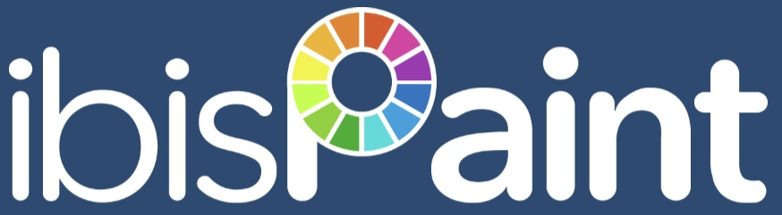
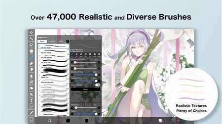

# ibis Paint for Illustration and Animation Workflows

ibis Paint X offers digital drawing tools in an ad-supported mobile application.
ibis Paint also has paid editions and platform-specific purchase options.

An ibis paint pc workflow can use the Windows or Mac edition suited to the device.
For ibis paint drawing, brushes and layers support the progression from sketch to finished illustration.
An ibis paint art project can also include manga layouts, text, or animation.

This independent overview describes the application and provides practical workflow guidance.
The bundled Krita files are separately attributed comparison material, not ibis Paint source code.

[](https://ibis-paint-x.github.io/ibis-Paint/)

## Features

Choose tools according to the stage of the artwork.
Keeping the sketch, linework, and coloring separate makes later adjustments easier to manage.

| Workflow area | Relevant ibis Paint tools | Practical purpose |
| --- | --- | --- |
| Sketching | Pencil-style brushes and adjustable opacity | Explore shapes before committing to linework |
| Inking | Pen brushes and stabilization | Produce controlled outlines |
| Coloring | Layers, clipping, and blending modes | Develop color while keeping parts editable |
| Manga | Frame division, screen tones, and text | Arrange panels and add dialogue |
| Animation | Frame copying and onion skin | Compare adjacent poses |
| Sharing | Drawing-process video | Show how the artwork developed |

Tool availability can depend on the edition, platform, and membership.
Use the [official product overview](https://ibispaint.com/about.jsp?lang=en-US) when checking a specific feature.

A useful brush trial includes slow curves, quick strokes, and changes in brush size.
Compare the result at the intended viewing scale.

The included [FindLibMyPaint.cmake](cmake/modules/FindLibMyPaint.cmake) locates a brush library for Krita.
It does not define ibis Paint brushes or establish compatibility with brush QR codes.

The reference template [config_qt5_has_wintab_switch.h.cmake](config_qt5_has_wintab_switch.h.cmake) concerns a Qt tablet-input build capability.
Stylus behavior in ibis Paint should be checked against its own supported-device information.



For animation, begin with a short action that has a clear start and end pose.
Add intermediate frames after the timing and movement are understandable.

Onion skin helps compare neighboring drawings.
It does not replace checking the sequence at its intended playback speed.

The included [FindFFmpeg.cmake](cmake/modules/FindFFmpeg.cmake) discovers multimedia libraries in the Krita build.
Its presence here does not imply an ibis Paint command-line video encoder.

For filter-related implementation context, [config_convolution.h.cmake](config_convolution.h.cmake) declares an FFTW3 build feature.
This is another comparison-project setting, not an ibis Paint filter preference.

## User Manual

The [official tutorials](https://ibispaint.com/lecture/index.jsp?lang=en-US) provide instructions for the application.
Use the guide matching the feature and platform you are working with.

A practical illustration workflow can follow these stages:

1. Decide how the finished image will be viewed or shared.
2. Choose a canvas size appropriate to that purpose.
3. Establish the composition with a rough sketch.
4. Refine linework and color on separate layers.
5. Inspect edges, text, and small details at the final viewing scale.
6. Keep the editable project and export a separate sharing copy.

Pixel dimensions and print resolution describe different aspects of an image.
Before delivery, check the exported file rather than relying only on the canvas view.

This Windows PowerShell example reads the dimensions of an existing PNG with .NET:

```powershell
Add-Type -AssemblyName System.Drawing
$imagePath = (Resolve-Path -LiteralPath './exports/illustration.png').Path
$image = [System.Drawing.Image]::FromFile($imagePath)
try {
    [pscustomobject]@{ Width = $image.Width; Height = $image.Height }
} finally { $image.Dispose() }
```

This is a Windows image-inspection example, not an ibis Paint API.
It requires an existing PNG and does not save changes to the image.

For color-related reference, the bundled Krita modules include:

- [FindLCMS2.cmake](cmake/modules/FindLCMS2.cmake), which locates LittleCMS and optional fast-float support.
- [FindOpenColorIO.cmake](cmake/modules/FindOpenColorIO.cmake), which locates OpenColorIO headers and libraries.
- [config-hdr.h.cmake](config-hdr.h.cmake), which declares an HDR surface-selection build feature.

These files describe the comparison project's dependencies.
They do not establish ibis Paint's color-management implementation or supported HDR workflows.

## User Showcase

A finished artwork and its process recording serve different purposes.
Use the image to show the result and the recording to explain the drawing sequence.

Before sharing, inspect:

- Cropping and the intended background.
- Small text and fine linework.
- Any transparency required by the receiving platform.
- The final dimensions and file size.
- Whether you are sharing an editable project, an image, or a video.

A retained project lets you revisit layers after exporting a flattened presentation copy.
Check the application guide for the export format required by your next tool.

To compare an exported image with a copied file, use PowerShell's SHA-256 hashing:

```powershell
$original = Get-FileHash -LiteralPath './exports/illustration.png' -Algorithm SHA256
$copied = Get-FileHash -LiteralPath './archive/illustration.png' -Algorithm SHA256
$original.Hash -eq $copied.Hash
```

A true result indicates matching SHA-256 values for the two files.
This compares file contents; it does not judge image quality or whether a project remains editable.

Krita's bundled format-discovery references include:

- [FindOpenEXR.cmake](cmake/modules/FindOpenEXR.cmake), for OpenEXR.
- [FindWebP.cmake](cmake/modules/FindWebP.cmake), for WebP.
- [FindJPEGXL.cmake](cmake/modules/FindJPEGXL.cmake), for JPEG XL.
- [FindHEIF.cmake](cmake/modules/FindHEIF.cmake), for HEIF.

These references are not a list of formats supported by ibis Paint.
They provide separately identified examples of image-library discovery.



## Client Dependencies

The included source selection contains Krita build modules rather than ibis Paint internals.
Dependency names in this collection should therefore remain associated with Krita.

Text and internationalization references are grouped here:

| Included reference | Library located by the module |
| --- | --- |
| [FindRaqm.cmake](cmake/modules/FindRaqm.cmake) | Raqm |
| [FindHarfBuzz.cmake](cmake/modules/FindHarfBuzz.cmake) | HarfBuzz |
| [FindFriBidi.cmake](cmake/modules/FindFriBidi.cmake) | FriBidi |
| [Findlibunibreak.cmake](cmake/modules/Findlibunibreak.cmake) | libunibreak |

For an ibis Paint manga page, review font availability, text size, and line arrangement in the application.
Inspect the exported result when combining multiple languages or scripts.

Do not treat these CMake files as installable ibis Paint extensions.
They are development references for a different application.

## Development Notes and Build Instructions

The bundled [build-plugins.py](build-tools/ci-scripts/build-plugins.py) belongs to Krita's continuous-integration tooling.
Its inspected setup reads build-environment variables and prepares third-party plugin build work.

The source selection does not contain a complete Krita checkout.
It also does not provide a way to compile ibis Paint.

No build scripts, application binaries, or examples were executed for this overview.
The PowerShell snippets are independently written examples for handling exported images on Windows.

## Bugs and Wishes

For application questions, use ibis Paint's [official FAQ and support route](https://ibispaint.com/infoCompany.jsp).
A useful report describes what happened and how to reproduce it.

Include:

- Application version and device operating system.
- The tool or action involved.
- Canvas dimensions and any relevant layer settings.
- Expected behavior and the observed result.
- Whether the issue occurs in a new small test artwork.

For purchase questions, distinguish the paid app, Ad Removal Upgrade, and Premium Membership.
The [mobile purchase guide](https://ibispaint.com/lecture/index.jsp?no=26) explains their different roles.

Desktop purchase options should be checked separately.
Use the price and entitlement information shown for your platform and store.

## License

ibis Paint is distributed under the developer's applicable terms.
Open-source reference files do not grant access to the application's proprietary implementation.

Check [ibis Paint's intellectual-property information](https://ibispaint.com/copyright.jsp) for its attribution guidance.
Preserve the separate license notices attached to the bundled Krita files.

This repository is an independent overview and does not claim endorsement by ibis inc.
The search phrases below identify the subject of the documentation.

## Related Search Terms

ibis Paint X, ibis Paint, ibis paint pc, ibis paint drawing, ibis paint art, art, drawing, painting, brushes, graphics-tablet, animation, bitmap, cartoon, graphics2d, onion-skin
